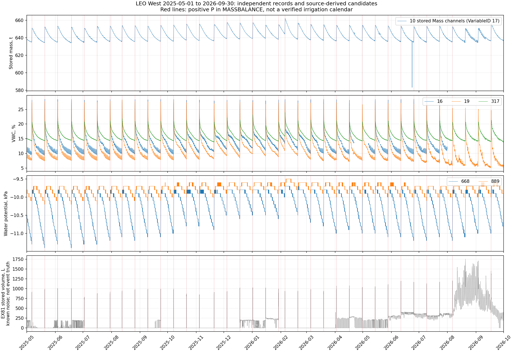

# Этап 0.1. Фактические поливы LEO West: проверка SensorDB

[Исследовательский маршрут](../README.md) · [План и критерий 0.1](../PLAN.md#preparation) · [Журнал](../JOURNAL.md)

## Результат: B, точный событийный календарь не восстановлен

За **01.05.2025–30.09.2026** установлены **37 дат согласованного роста массы
склона и объёмной влажности возле W_x1_y4**. Это сильное косвенное свидетельство
увлажнения, согласующееся с поливом. Однако начало, окончание, число отдельных
включений внутри суток, поданный объём, схема орошения и тип эксперимента
достоверно не установлены. Полнота списка относительно всех реальных поливов
не доказана. **Этап 0.1 остаётся открытым.**

Сохранён [реестр 37 дат](../data/stage01_irrigation/wetting_dates.csv).
В нём исходные идентификаторы, независимые изменения, метод, статус и ограничения;
поля времени события, длительности, объёма и интенсивности оставлены пустыми.
`observation_start/end` обозначают календарные сутки наблюдений, **не границы полива**.
Это реестр свидетельств, а не подмена требуемого событийного календаря.

Главное обнаруженное препятствие: готовая таблица `MASSBALANCE` пропускает
**20.08.2026 и 03.09.2026**. В каждый из этих дней `P_KG=0` во всех 24 часовых
строках, а `MASS=-9999` в 23 из 24 строк. Между тем исходные десять каналов
массы имеют 96 полных отсчётов за каждый день, а независимые VWC 19 и 317
согласованно растут. Поэтому нулевое `P_KG` не доказывает отсутствия полива.
[Исходные строки-контрпримеры](../data/stage01_irrigation/massbalance_counterexamples.csv).

| Дата | Изменение сохранённой массы между крайними суточными отсчётами, кг | VWC 19, процентных пунктов | VWC 317, процентных пунктов |
|---|---:|---:|---:|
| 20.08.2026 | +14603.368015 | +10.664009 | +5.806624 |
| 03.09.2026 | +14671.822923 | +11.365543 | +5.921522 |

Эти изменения массы **не обозначают поданный объём воды**.

## Происхождение и границы проверки

Проверены локальная `main` и удалённая `origin/main`:
`5499cb9a4060e2e6480e0673ff047657119b4270`, 23.10.2026.
Период задан полуинтервалом `[2025-05-01 00:00:00, 2026-10-01 00:00:00)`.
Временные метки Oracle сохранены без дополнительной коррекции.

Прочитаны `AGENTS.md`, правила Research_log, действующие README/PLAN,
`Sensors_Description/workflow_memory.md`, существующий модуль подключения
`sensorDB.py`, `Row_data/README.md`, инвентарь LEO West и
`LEOSensorDBdescription.pdf` (схема на стр. 1; Variables на стр. 4–5,
Methods/Sensors на стр. 8–9; SensorLog/Calibrations на стр. 10–11).
Описание PDF 2015 года сверено с реальной структурой Oracle, а не принято
за актуальную схему без проверки.

Из Oracle прочитаны `SENSORS`, `VARIABLES`, `LOCATIONS`, `UNITS`, `METHODS`,
`SENSORTYPES`, `CALIBRATIONS`, `CALIBRATIONPARAMETERS`, `SENSOROUTPUT`,
`SENSORLOG`, `DAQMETHODS`, `QUALITYCONTROL`, `EXPERIMENTLOG`, определения
22 представлений, состав таблиц и индексов. Измерения всех выбранных каналов
хранятся в `LEO_WEST.DATAVALUES`. Дополнительно проверены `MASSBALANCE`
и границы `OUTFLOWS_OLD/NEW`; последние заканчиваются 04.10.2018 и не дают
альтернативных измерений для выбранного периода.

Всего выбрано **100 каналов**: EX81 2; Model3130 20 (включая найденный
физический выход VariableID 17); NovaLynx 14; PE102 12; 5TM 50; MPS-2 2.
Соседство 5TM определено геометрически: $-1\le x\le3$, $2\le y\le6$ м,
все имеющиеся глубины, включая все 5TM в $(1,4)$.
Это выбор ближайших соседних рядов инвентаря, не отбор по желаемому отклику.

Получены **3 828 754 строки**. У 77 каналов есть записи, у 63 — хотя бы одно
конечное значение, отличное от `-9999`. У 23 каналов записей нет; ещё 14
содержат только `-9999`. Термин `usable` в CSV означает только этот
технический признак, **не метрологическое подтверждение исправности**.
Дубликатов `VALUEID`, точных временных меток внутри канала и повторных
15-минутных ячеек внутри канала не найдено.

Индекс `DATAVALUES_INDX1(LOCALDATETIME)` использован в 17 месячных запросах
с ограничениями исходного столбца времени. Наибольшая длительность одного
месячного запроса с получением и сохранением строк — 40.633 с.
Нет сканирования всей многолетней истории `DATAVALUES` по отдельным сенсорам.
Запросы выполнялись последовательно, без единого SCN; снимок фиксируют
`VALUEID`, исходные времена и SHA-256. Все операции Oracle — `SELECT`.
[Запросы](../data/stage01_irrigation/queries.jsonl) ·
[Происхождение](../data/stage01_irrigation/provenance.json) ·
[Проверки](../data/stage01_irrigation/validation.json).

## 1. Масса и отток

### Model3130: сырой сигнал и сохранённые килограммы

Для 1066–1075 имеются оба выхода: VariableID 15 (`LCout`, метаданные `mV/V`)
и VariableID 17 (`Mass`, `kg`). Каждый из 20 каналов содержит 49 724 строки,
из них 49 708 без служебного значения. Десять одновременных значений массы
доступны в 49 708 из 49 728 номинальных 15-минутных ячеек.

Калибровка 12 от 19.06.2012 содержит индивидуальные `k` и `MaxLoad`:
`k=1.6112…2.0196`, `MaxLoad=220000` или `333000`.
Единицы `MaxLoad`, дополнительное масштабирование и полная фактически
применённая формула в доступном описании не раскрыты. Прямое применение
`LCout * MaxLoad/k` **не воспроизводит** сохранённую массу: эмпирический
коэффициент отличается примерно в 447–454 раза. Это диагностическое сравнение,
а не новая принятая калибровка. Ряды 15 имеют грубое округление относительно
выхода 17. **Сырой сигнал 15 в килограммы не переименован и не пересчитан.**
[Сопоставление двух выходов](../data/stage01_irrigation/mass_conversion_checks.csv).

Для изменения запасов можно изучать разность **уже сохранённых** выходов 17,
явно сохраняя ограничения калибровки и возможные механические/тепловые влияния.
Сумма десяти выходов воспроизводит `MASSBALANCE.MASS` в 11 780 общих
неслужебных часах с максимальным расхождением $2.33\cdot10^{-10}$ кг.
Следовательно, это один и тот же массовый источник, а не два независимых
свидетельства. Оценка водного запаса требует также постоянства прочих
компонент массы; она не становится объёмом поданной воды автоматически.

### NovaLynx и PE102: накопленные счётчики

У 1086–1097 и 1258 присутствуют VariableID 13 и 14. Их значения **накопительные
между сбросами**, хотя `VARIABLES.DATATYPE` для обоих выходов говорит
`Incremental`, `TIMESUPPORT=15 min`. Это установлено по постоянным значениям
при отсутствии импульсов, длительному монотонному накоплению, общим падениям
счётчиков и определениям `DATA_RAINGAGES_INC`/`DATA_FLOWMETERS_INC`, которые
явно берут разность соседних значений.

NovaLynx: $V=kC$ в литрах. Текущие коэффициенты калибровки 35 от 28.01.2023:

| SensorID | 1086 | 1087 | 1088 | 1089 | 1090 | 1091 | 1258 |
|---|---:|---:|---:|---:|---:|---:|---:|
| L/count | 0.029409 | 0.030172 | 0.034125 | 0.031355 | 0.032133 | 0.028206 | 0.033983 |

PE102: $V=C/1000$ L; калибровка 10 от 16.03.2012, `k=1000`.
Отношения обоих выходов проверены по всем одновременно записанным
неслужебным парам, а не по одному примеру.
[Проверка преобразований](../data/stage01_irrigation/counter_conversion_checks.csv).

В `SENSOROUTPUT` для VariableID 14 встречается перевёрнутый диапазон
`VALIDRANGEFROM=0`, `VALIDRANGETO=-9999`; для счётчиков 13 указаны пределы,
не согласованные с длительным накоплением. Эти поля не применялись как
автоматическая маска качества. Они дополнительно показывают, почему
интерпретацию нельзя определять только по метаданным.

У каждого из 13 выходных счётчиков найдены четыре падения:
24.07.2025 около 08:30; 21.04.2026 около 14:00; 19.05.2026 около 03:30;
17.08.2026 около 17:45 (точные времена и обе строки сохранены).
Причина в журнале гидрологических датчиков не описана; это наблюдаемые
разрывы накопления, не документированные акты обслуживания.
Через такой разрыв нельзя считать отрицательный расход, брать модуль
разности или автоматически заменять её нулём.
[Разности и исходные ID](../data/stage01_irrigation/counter_decreases.csv) ·
[Статистика](../data/stage01_irrigation/counter_summary.csv).

Изменения **каждого отдельного** счётчика за 37 выделенных суток сохранены
в [сопоставлении оттока](../data/stage01_irrigation/wetting_date_outflow_evidence.csv).
Например, у 1088, 1089, 1094 и 1095 во все эти дни есть положительные изменения,
а 1086 и 1092 за эти сутки не изменяются. Отсутствие импульсов отдельного
отвода не означает отсутствия полива. NovaLynx и PE102 имеют попарно одинаковые
координаты выходов; схема распределения потока и правило объединения
диапазонов не установлены. Поэтому их объёмы не складываются в общий отток
без проверки гидравлической схемы.

### Почему готовый водный баланс не даёт независимого дождя

`MASSBALANCE` содержит 15 007 строк трёх разных масштабов:
12 431 `hr`, 2 065 `6hr`, 511 `daily`. Их нельзя суммировать вместе.
Повторные времена разных масштабов не считаются дубликатами одного измерения.
Часовой `MASS` имеет 651 служебное значение, а `Q_KG` — четыре отрицательных
значения, связанных по времени с разрывами накопления.

В 11 724 строках без служебных полей выполняется
$$
ET_{\rm stored}=P_{\rm stored}-Q_{\rm stored}-\Delta M_{\rm stored}
$$
с максимальным остатком $4.55\cdot10^{-13}$ кг.
Это алгебраическое замыкание, не независимая оценка испарения.
Формула вычисления `P`, причины отбраковки массы и история её алгоритма
в доступных таблицах/описаниях не найдены. `ALL_SOURCE` для `LEO_WEST`
не возвращает программных объектов; отсутствие доступного кода не означает,
что такого кода нет у владельца системы.

Для независимого восстановления поданной воды из
$P=\Delta S+Q+ET$ нужны проверенные $\Delta S$, объединённый отток и независимое
$ET$ либо количественно обоснованная его оценка. Использовать для этого
`ET`, уже рассчитанное из того же `P`, означало бы круговой расчёт.
[Контроль согласованности](../data/stage01_irrigation/massbalance_consistency.json).

## 2. Независимые свидетельства возле W_x1_y4

<!-- BEGIN CHANNEL_TABLE -->
| SensorID / VariableID | Строк | Неслужебных | Первое неслужебное время | Последнее неслужебное время |
|---|---:|---:|---|---|
| 18/6 | 49724 | 0 | нет | нет |
| 172/6 | 0 | 0 | нет | нет |
| 393/6 | 0 | 0 | нет | нет |
| 16/6 | 49724 | 42286 | 2025-05-01 00:00:01 | 2026-07-31 21:15:01 |
| 19/6 | 49724 | 49670 | 2025-05-01 00:00:01 | 2026-09-30 23:45:01 |
| 317/6 | 49724 | 49687 | 2025-05-01 00:00:01 | 2026-09-30 23:45:01 |
| 668/7 | 49724 | 49705 | 2025-05-01 00:00:01 | 2026-09-30 23:45:01 |
| 889/7 | 49724 | 49705 | 2025-05-01 00:00:01 | 2026-09-30 23:45:01 |
<!-- END CHANNEL_TABLE -->

5TM непосредственно в $(1,4)$: 18 (5 см) содержит только `-9999`,
172 (20 см) и 393 (50 см) не имеют строк за выбранные 17 месяцев.
Новых 5TM в тех же координатах в актуальных `SENSORS/LOCATIONS` не найдено.
Их историческая дата последнего исправного значения вне этого периода
отдельно не определялась. Статусы `A` и инвентарное `present` не заменяют
проверку реальных записей.

У 16 $(x,y,z)=(-1,4,0.05)$ м последнее неслужебное значение —
31.07.2026 21:15:01. Значительные разрывы: 21.04.2026 14:00–06.05.2026 22:30
и с 31.07.2026 21:30 до конца периода (границы здесь — ячейки покрытия).
Датчики 19 и 317 находятся в $(2,4)$, на глубинах 5 и 35 см, в метре по
горизонтали от выбранной вертикали; 16 — в двух метрах. Они дают соседнее
свидетельство, но не заменяют VWC непосредственно в W_x1_y4.

Всего из 50 ближайших 5TM неслужебные значения найдены у 13:
7, 8, 16, 17, 19, 160, 163, 185, 311, 317, 323, 398, 399.
Кроме 16, частично прекратил работу 17: последний неслужебный отсчёт
31.08.2025 09:00:00. Полные количества, координаты и реальные разрывы
приведены в [паспорте 100 каналов](../data/stage01_irrigation/channel_summary.csv).

MPS-2 668 и 889 действительно записываются на 20 и 50 см в W_x1_y4.
Диапазоны за период: **−11.4…−9.7** и **−10.2…−9.5 kPa** соответственно.
Наблюдаемая дискретность 0.1 kPa не равна точности. В руководстве MPS-2
указаны погрешность ±(25% показания + 2 kPa) в диапазоне −9…−100 kPa и
ограничения влажного края. При −10 kPa это около ±4.5 kPa, поэтому малые
изменения 889 нельзя использовать для точного определения границ полива.
Качественный согласованный ход 668 полезен; самостоятельная точная датировка
по нему не подтверждена.
[Руководство производителя, стр. 2 и 9–10](https://publications.metergroup.com/Retired%20and%20Discontinued/Manuals/13755_MPS-2and6_Web.pdf).
Водный потенциал в VWC не пересчитывался: характеристики водоудержания нет.

## 3. Сопоставление с EX81

993/13 и 993/14 содержат по 49 727 конечных записей, без `-9999`,
из 49 728 номинальных ячеек. Техническое покрытие почти полное,
**но измерительная надёжность не следует из покрытия**.

Для EX81 характерны интервальные импульсы, а не длительное накопление
выходных счётчиков: метаданные `Incremental`, 15 min согласуются с характером
записи. Выход 14 равен выходу 13, умноженному на сохранённый коэффициент
0.026306 L/count. Пара 13/14 — два представления одного датчика, не независимые
свидетельства. Производитель определяет K-factor EX80/EX81 в pulses/gallon;
сама спецификация не подтверждает исправность конкретного канала.
[Руководство EX80, раздел K-factor, стр. 8](https://www.seametrics.com/wp-content/uploads/EX80Instructions06-04.pdf).

Известное предупреждение Matej Durcik от 02.10.2026 о сильном нерегулярном
шуме после середины сентября 2020 года принято как ограничение этапа.
В выбранном периоде 20 519 положительных отсчётов EX81 распределены гораздо
шире выделенных согласованных дат. Например, 01.05.2025 имеются длительные
ненулевые показания при суточном уменьшении массы и VWC. После августа 2026
фон EX81 особенно велик. Положительное показание или пик не принимаются
за полив; сумма этих литров не выдаётся за поданную воду. Автоматическое
распознавание поливов по EX81 не выполнялось.



Красные линии показывают только 35 дат с положительным часовым `P` в источнике.
Два согласованных увлажнения без такого `P` остаются видны в массе и VWC.

## 4. Что именно восстановлено и с какой полнотой

Сначала рассмотрены масса и выходные счётчики, затем VWC/MPS-2 и EX81.
Для воспроизводимого **описания согласованности**, а не принятого детектора
полива, сопоставлены знаки изменений между первым и последним реальными
неслужебными отсчётами каждых календарных суток. Положительные изменения
массы десяти опор и обоих VWC 19/317 совместно найдены в 37 сутках.
Все 518 суточных строк, включая остальные дни, доступны в
[полной таблице изменений](../data/stage01_irrigation/daily_independent_changes.csv).
Никаких амплитудных/временных порогов распознавания или предполагаемого
двухнедельного расписания не вводилось. Ноль здесь — знак изменения величины,
а не подобранная граница исправности или интенсивности полива.

Изменения на этих 37 датах составляют 14 603…18 548 кг сохранённой массы,
7.640…11.366 процентных пунктов VWC 19 и 4.884…6.875 п. п. VWC 317.
Это фактически полученные диапазоны, **не пороги отбора**.
Даты не брались из ожидаемой периодичности, в том числе 18.06.2025,
20.11.2025 и 05.02.2026. Между датами возможны невыявленные слабые/короткие
воздействия, несколько включений за сутки или поливы на фоне убывания запасов.

<!-- BEGIN DATE_TABLE -->
| Месяц | Даты согласованного увлажнения |
|---|---|
| 2025-05 | 06, 20 |
| 2025-06 | 03, 18 |
| 2025-07 | 02, 16, 30 |
| 2025-08 | 12, 26 |
| 2025-09 | 09, 23 |
| 2025-10 | 07, 21 |
| 2025-11 | 04, 20 |
| 2025-12 | 04, 18 |
| 2026-01 | 01, 15, 29 |
| 2026-02 | 05, 19 |
| 2026-03 | 05, 19 |
| 2026-04 | 02, 16, 30 |
| 2026-05 | 14, 28 |
| 2026-06 | 11, 25 |
| 2026-07 | 09, 23 |
| 2026-08 | 06, 20 |
| 2026-09 | 03, 17 |
<!-- END DATE_TABLE -->

Различаются четыре статуса:

| Вид свидетельства | Полученный результат |
|---|---|
| Непосредственный журнал фактического включения | Доступных подтверждённых событий 0: `EXPERIMENTLOG` пуст, журнал SCADA не найден среди доступных источников |
| Согласованные независимые измерения | 37 дат увлажнения, совместимых с поливом; временная локализация пока только календарными сутками |
| Сомнительные признаки | Дополнительные пики/ненулевой фон EX81; их количество не объявлено числом событий |
| Неопределённые интервалы | Точные границы и поданное количество воды не установлены во всех 17 месяцах; вне 37 дат отсутствие полива не доказано |

Гидрологических записей об отказах/заменах в `SENSORLOG` нет; всего там четыре
записи о других каналах. `QUALITYCONTROL` пуст. Это недостаток документирования,
а не доказательство отсутствия отказов. Для точного событийного календаря
не хватает фактических включений/выключений SCADA или сопоставимого журнала,
проверенной схемы орошения и оттока, действующей цепочки калибровки массы,
происхождения `MASSBALANCE.P` и независимого ограничения испарения.
Письма в рамках этой проверки не отправлялись.

## 5. Покрытие всех 17 месяцев

Номинальная частота — 900 с; наиболее частые реальные интервалы 899, 900 и
901 с. Исходные секунды не исправлялись. Округление вниз до 15 минут
использовано только для диагностики покрытия и сопоставления десяти опор;
повторные ячейки не усреднялись, отсутствующие значения не заполнялись.
Для каждой строки реестров доказательств сохранены реальные времена и `VALUEID`.

<!-- BEGIN MONTH_TABLE -->
| Месяц | Всего ячеек | Масса 10 | EX81 | VWC 16 | VWC 19 | VWC 317 | Каждый MPS-2 | Дат увлажнения |
|---|---:|---:|---:|---:|---:|---:|---:|---:|
| 2025-05 | 2976 | 2976 | 2976 | 2976 | 2976 | 2976 | 2976 | 2 |
| 2025-06 | 2880 | 2880 | 2880 | 2880 | 2880 | 2880 | 2880 | 2 |
| 2025-07 | 2976 | 2976 | 2976 | 2976 | 2974 | 2976 | 2976 | 3 |
| 2025-08 | 2976 | 2976 | 2976 | 2976 | 2975 | 2976 | 2976 | 2 |
| 2025-09 | 2880 | 2880 | 2880 | 2880 | 2863 | 2875 | 2880 | 2 |
| 2025-10 | 2976 | 2976 | 2976 | 2976 | 2972 | 2974 | 2976 | 2 |
| 2025-11 | 2880 | 2880 | 2880 | 2880 | 2875 | 2874 | 2880 | 2 |
| 2025-12 | 2976 | 2976 | 2976 | 2976 | 2976 | 2976 | 2976 | 2 |
| 2026-01 | 2976 | 2976 | 2976 | 2976 | 2976 | 2975 | 2976 | 3 |
| 2026-02 | 2688 | 2687 | 2687 | 2687 | 2686 | 2685 | 2687 | 2 |
| 2026-03 | 2976 | 2971 | 2976 | 2971 | 2971 | 2971 | 2971 | 2 |
| 2026-04 | 2880 | 2877 | 2880 | 1974 | 2875 | 2875 | 2876 | 3 |
| 2026-05 | 2976 | 2974 | 2976 | 2316 | 2973 | 2973 | 2973 | 2 |
| 2026-06 | 2880 | 2878 | 2880 | 2878 | 2876 | 2878 | 2878 | 2 |
| 2026-07 | 2976 | 2974 | 2976 | 2964 | 2973 | 2974 | 2974 | 2 |
| 2026-08 | 2976 | 2973 | 2976 | 0 | 2972 | 2971 | 2972 | 2 |
| 2026-09 | 2880 | 2878 | 2880 | 0 | 2877 | 2878 | 2878 | 2 |
<!-- END MONTH_TABLE -->

Здесь числа обозначают **неслужебные 15-минутные ячейки**, не метрологическую
пригодность и не полноту календаря поливов. Столбец массы требует все десять
опор одновременно. Оба MPS-2 имеют одинаковое число неслужебных ячеек по месяцам.
[Все 1700 строк канал–месяц](../data/stage01_irrigation/monthly_coverage.csv) ·
[Все пропуски, отдельно отсутствие строк и отсутствие неслужебных значений](../data/stage01_irrigation/gaps.csv) ·
[Распределение интервалов](../data/stage01_irrigation/cadence.csv).

## 6. Точное предложение по variables_schema.xlsx, без редактирования

Целесообразно добавить лист **Hydrology_West** с **48 строками**:
993 × (13,14); 1066–1075 × (15,17); 1086–1091 и 1258 × (13,14);
1092–1097 × (13,14). Список строк, единиц, координат и селекторов уже подготовлен
в [предложении CSV](../data/stage01_irrigation/workbook_additions_proposed.csv).
Этот файл **не является изменённой книгой**.

Сохранить существующую структуру полей A:AH: N — `LEO_WEST.DATAVALUES`,
O — точный `sensorid/variableid`, P — `LOCALDATETIME`, Q — `DATAVALUE`,
R — исходная единица Oracle, AA — ограниченный запрос, AD:AG — идентификатор,
код, имя переменной и единица. Для LCout не записывать неподтверждённое
преобразование в kg. Для накопленных счётчиков явно описать дифференцирование
между сбросами. Для EX81 — неисправность; для Mass — сохранённый выход 17 и
ограничения проверки калибровки.

Добавить поля аудита **AI:AR**: начало периода; исключительная верхняя граница;
число исходных строк; число неслужебных строк; первое/последнее наблюдение
в периоде; первое/последнее неслужебное значение в периоде; интерпретация/
неисправности; ссылка на доказательства. X/Y полного исторического покрытия
не подменять границами этого 17-месячного аудита.

52 выбранных канала 5TM/MPS-2 уже представлены на `Humidity`; их не дублировать
новыми строками. Для них предложены те же дополнительные поля аудита с
привязкой к [channels.csv](../data/stage01_irrigation/channels.csv).
Существующие исторические X/Y имеют основанием `DATACATALOG`, который для
проверенных старых каналов заканчивается 13.08.2018. Они не отражают текущую
доступность. Исправление исторических границ требует отдельной проверки
всей истории; текущий аудит подтверждает только заданный период.
Ни один лист книги не изменён.

## Воспроизведение и сохранение

Исполняемый код: [stage01_irrigation_audit.py](../../sensorDB/stage01_irrigation_audit.py).
Он использует существующее подключение `sensorDB.py`, thick mode и настроенный
локальный `.env`; секреты в снимок не попадают.

Повторить расчёты по сохранённому снимку без Oracle, из корня репозитория:

```bash
MPLCONFIGDIR=/tmp/co2flux-mpl python3 Project_description/sensorDB/stage01_irrigation_audit.py analyze
python3 Project_description/sensorDB/stage01_irrigation_audit.py validate
```

Сырьё находится в `data/stage01_irrigation/raw/` (17 Parquet) и локальном
`massbalance.csv`; оба исключены локальным `.gitignore` и не публиковались.
SHA-256 и количества — в [raw_manifest.json](../data/stage01_irrigation/raw_manifest.json)
и `provenance.json`. Первичная выгрузка выполнена командами `metadata`,
`context`, `measurements`, читающими Oracle; `measurements` возобновляет
существующие месячные части. Для нового независимого снимка потребуется
отдельная версия каталога данных и документированное изменение настройки `OUT`.
Текущий зафиксированный снимок не обновлять незаметно.

`PLAN.md`, книга датчиков и все ранее отслеживаемые результаты других этапов
проверяются по сохранённым контрольным суммам. Научный маршрут, выбранная
вертикаль и период не пересматривались. Обработка измерений ограничена
гидрологией этапа 0.1; перехода к другим исследованиям нет.

[Назад к исследовательскому маршруту](../README.md) · [Журнал](../JOURNAL.md)
